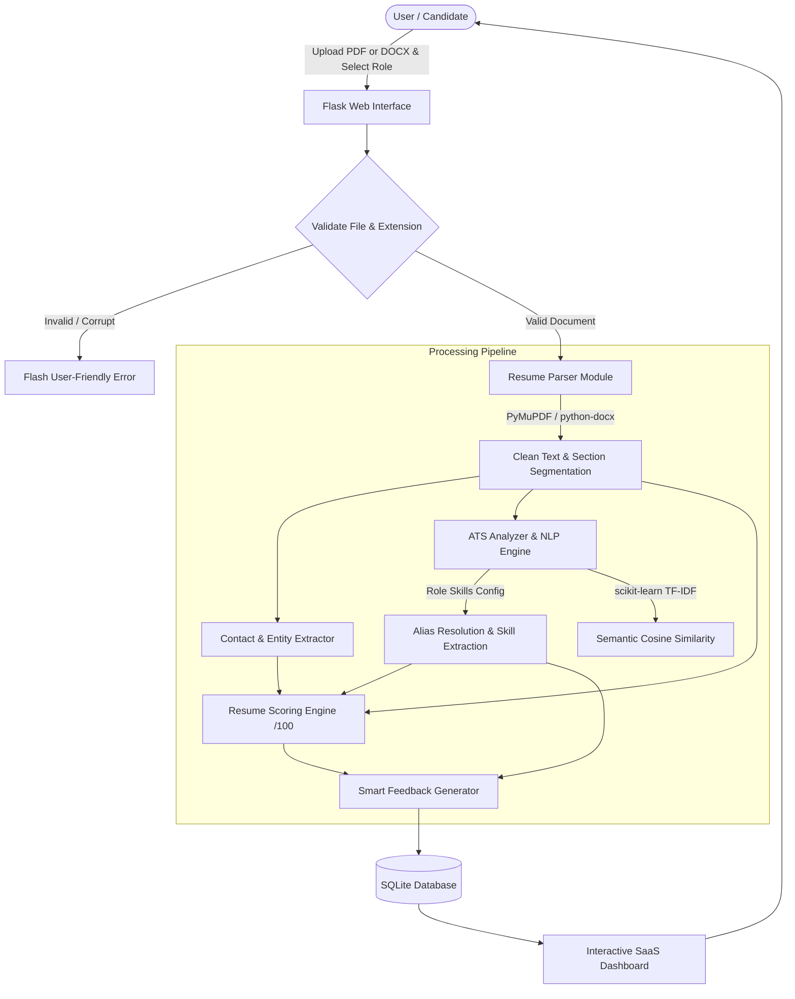

# Smart Resume Analyzer with AI-Based Feedback

[](https://www.python.org/)
[](https://flask.palletsprojects.com/)
[](https://scikit-learn.org/)
[](https://pymupdf.readthedocs.io/)
[](https://www.sqlite.org/)
[](#)

An intermediate-level AI capstone project designed for academic evaluation. Built using full-stack Python, Flask, PyMuPDF, python-docx, and scikit-learn. Delivers transparent, explainable ATS compatibility evaluations, role-aligned skill gap analysis, and evidence-backed recommendations without relying on third-party paid APIs or opaque LLM services.

---

## Table of Contents

- [Project Overview](#project-overview)
- [System Architecture](#system-architecture)
- [Core Modules](#core-modules)
  - [Module 1: Resume Parser](#module-1-resume-parser)
  - [Module 2: Resume Scoring Engine](#module-2-resume-scoring-engine)
  - [Module 3: ATS & NLP Matching Engine](#module-3-ats--nlp-matching-engine)
  - [Module 4: Smart Feedback Generator](#module-4-smart-feedback-generator)
  - [Module 5: Interactive SaaS Dashboard](#module-5-interactive-saas-dashboard)
- [Database & Privacy Architecture](#database--privacy-architecture)
- [Technology Stack](#technology-stack)
- [Project Directory Structure](#project-directory-structure)
- [Installation & Quickstart](#installation--quickstart)
- [Running Automated Tests](#running-automated-tests)
- [Sample Resumes & Test Datasets](#sample-resumes--test-datasets)
- [Deployment Guide (Render)](#deployment-guide-render)
- [Academic Heuristic Disclaimer](#academic-heuristic-disclaimer)

---

## Project Overview

Modern Applicant Tracking Systems (ATS) reject up to 75% of qualified applicants due to formatting nuances, non-standard section titling, and keyword mismatches. Commercial ATS tools typically operate as opaque black boxes or depend on costly external LLM APIs with high latency, rate limits, and data privacy risks.

**Smart Resume Analyzer** solves this problem by providing:
1. **Explainable Rule-Based Diagnostics**: A deterministic 100-point scoring heuristic across 6 resume dimensions.
2. **Normalized NLP Skill Extraction**: An alias dictionary resolving abbreviations (e.g., `K8s` &rarr; `Kubernetes`, `Py` &rarr; `Python`, `ML` &rarr; `Machine Learning`).
3. **Semantic Profile Matching**: `scikit-learn` TF-IDF Vectorization and Cosine Similarity measuring semantic alignment with role benchmarks.
4. **Zero Paid APIs**: Runs completely locally, reliably, and deterministically.
5. **Strict Data Privacy**: Temporary files are deleted immediately after parsing; only structured metrics are saved, isolated per user session.

---

## System Architecture



---

## Core Modules

### Module 1: Resume Parser (`app/parser.py`)
- **Multi-Format Ingestion**: Supports `.pdf` documents via **PyMuPDF** (`pymupdf`) and `.docx` documents via **python-docx**.
- **Section Segmentation**: Regex pattern state machine detects standard resume headers (`Education`, `Experience`, `Skills`, `Projects`, `Certifications`, `Contact`).
- **Contact Extraction**:
  - Email (RFC-compliant regex)
  - Phone (US, international, dotted, dashed, parenthesized)
  - LinkedIn Profile URL
  - GitHub Profile URL
  - Portfolio / Personal Website URL
  - Candidate Name extraction heuristic
- **Defensive Engineering**: Rejects unsupported formats, empty files (0 bytes), and documents with insufficient text (detecting scanned images or photos lacking an OCR layer).

### Module 2: Resume Scoring Engine (`app/scoring.py`)
Calculates an explainable score out of 100 across six weighted dimensions:

| Dimension | Points | Evaluation Criteria |
| :--- | :---: | :--- |
| **Contact Information** | **15** | Valid email (5 pts), Phone (4 pts), LinkedIn / GitHub (4 pts), Name (2 pts) |
| **Education Details** | **15** | Dedicated section (6 pts), Recognized degree title (5 pts), Institution name (4 pts) |
| **Technical Skills** | **20** | Dedicated section (6 pts), Technical breadth & skill count (up to 14 pts) |
| **Projects & Portfolio** | **20** | Dedicated section (6 pts), Depth & detail (8 pts), Implementation keywords/metrics (6 pts) |
| **Work Experience** | **15** | Dedicated section (5 pts), Recognized role titles (5 pts), Chronological dates (5 pts) |
| **Structure & Impact** | **15** | 4 core sections (5 pts), Optimal length 350-850 words (4 pts), Action verbs (3 pts), Quantified impact (3 pts) |
| **Total** | **100** | Letter Grades: **A** (85+), **B** (70-84), **C** (55-69), **D** (<55) |

### Module 3: ATS & NLP Matching Engine (`app/ats_analyzer.py`)
Supports four primary technical industry roles configured in `app/data/role_skills.json`:
1. **Data Analyst**
2. **Web Developer**
3. **AI Engineer**
4. **Cloud Engineer**

Key NLP mechanics:
- **Alias Resolution**: Canonical normalization mapping variations like `reactjs`, `react.js`, `ts`, `py`, `k8s`, `tf`, `gcp`, `mongo` to standard vocabulary.
- **Set Intersection**: Classifies skills into **Matched Core**, **Missing Core**, **Matched Secondary**, and **Missing Secondary**.
- **TF-IDF Semantic Similarity**: `TfidfVectorizer(ngram_range=(1,2))` builds n-gram vectors comparing the resume against augmented benchmark job profiles, calculating cosine similarity.
- **Composite ATS Score**: Weighted combination of 60% Required Match + 20% Recommended Match + 20% Semantic TF-IDF Similarity.

### Module 4: Smart Feedback Generator (`app/feedback.py`)
Produces actionable, prioritized recommendations categorized into **High**, **Medium**, and **Low** severity:
- **Evidence-Backed**: Every recommendation details the exact finding from the resume (e.g., *"No standard telephone contact number was identified."*).
- **Concrete Next Steps**: Explains precisely how the candidate should update their resume.
- **Academic Integrity**: Adheres strictly to honest resume writing—never invents past positions or qualifications.

### Module 5: Interactive SaaS Dashboard (`app/templates/result.html`)
- Built with **Bootstrap 5**, **HTML5**, **CSS3**, and **Vanilla JavaScript**.
- **Circular Score Gauge**: Pure CSS `conic-gradient` meter indicating score and grade tier.
- **ATS Role Match Gauge**: Dynamic progress bar with required vs. recommended counters.
- **Categorized Badges**: Color-coded badges for matched and missing skills.
- **Filterable Recommendations**: Interactive filter buttons (`All`, `High`, `Medium`, `Low`).
- **Print & PDF Export**: Specialized `@media print` CSS formats the dashboard cleanly for PDF export or paper printing.

---

## Database & Privacy Architecture

- **SQLite Engine**: Handled via `Flask-SQLAlchemy`.
- **Zero Full-Text Retention**: Raw resume body text is parsed in memory and **never permanently saved** to the database, ensuring candidate privacy.
- **Session-Based Privacy Isolation**: Each visitor is assigned a cryptographic UUID session identifier. Analysis records are scoped to `session_id`. Users cannot inspect or guess URLs to view other candidates' resumes.
- **Analysis History Management**: Candidates can review previous evaluations from their current session or wipe their history with a single click.

---

## Technology Stack

| Component | Technology | Version | Description |
| :--- | :--- | :--- | :--- |
| **Backend** | Python | 3.10+ | Core programming language |
| **Web Framework** | Flask | 3.1.3 | Lightweight, secure WSGI web framework |
| **ORM / DB** | Flask-SQLAlchemy | 3.1.1 | SQLite object relational mapping |
| **PDF Extraction** | PyMuPDF | 1.28.2 | Fast, high-accuracy PDF text extraction |
| **DOCX Extraction** | python-docx | 1.2.0 | Microsoft Word XML document parser |
| **NLP & Vectors** | scikit-learn | 1.9.1 | TF-IDF vectorization & Cosine Similarity |
| **Frontend UI** | Bootstrap 5 | 5.3.3 | Responsive grid and modern SaaS components |
| **Icons** | Bootstrap Icons | 1.11.3 | Vector icon library |
| **Testing** | pytest | 9.1.1 | Automated unit and integration testing |
| **Production WSGI**| Gunicorn | 21.2+ | Production WSGI HTTP server for Linux |

---

## Project Directory Structure

```
smart-resume-analyzer/
├── app/
│   ├── __init__.py           # Flask app factory, config loading, DB setup
│   ├── models.py             # SQLite AnalysisRecord model with JSON helpers
│   ├── routes.py             # HTTP endpoints & session-scoped controllers
│   ├── parser.py             # ResumeParser (PyMuPDF & python-docx, section segmentation)
│   ├── scoring.py            # ResumeScorer (heuristic 100-pt scoring engine)
│   ├── ats_analyzer.py       # ATSAnalyzer (skill normalization, TF-IDF cosine similarity)
│   ├── feedback.py           # FeedbackGenerator (prioritized actionable recommendations)
│   ├── data/
│   │   ├── role_skills.json  # 4 target roles, required/recommended skills & aliases
│   │   └── action_verbs.json # Catalog of 90+ strong resume action verbs
│   ├── static/
│   │   ├── css/
│   │   │   └── style.css     # Custom SaaS theme, circular meter, print styles
│   │   ├── js/
│   │   │   └── main.js       # Drag & drop upload, loading states, filters
│   │   └── img/
│   └── templates/
│       ├── base.html         # Base layout with navbar, alerts, footer
│       ├── index.html        # Landing page, role selection, upload dropzone
│       ├── result.html       # SaaS Dashboard with score meters and gap matrix
│       ├── history.html      # Session analysis history table
│       ├── 404.html          # Not found error template
│       └── 500.html          # Server error template
├── sample_resumes/           # Real test resumes (PDF & DOCX)
│   ├── generate_samples.py   # Automated sample resume generator
│   ├── sample_ai_engineer.docx
│   ├── sample_web_developer.docx
│   ├── sample_data_analyst.pdf
│   ├── sample_cloud_engineer.pdf
│   └── sample_weak_resume.docx
├── tests/                    # Automated test suite (20 tests)
│   ├── __init__.py
│   ├── test_parser.py        # PDF/DOCX text & section extraction tests
│   ├── test_scoring.py       # 100-pt transparent scoring tests
│   ├── test_ats.py           # Skill normalization & role-switching tests
│   ├── test_feedback.py      # Actionable recommendations & integrity tests
│   └── test_routes.py        # End-to-end web workflows & privacy tests
├── instance/                 # SQLite database storage
├── uploads/                  # Temporary upload directory (.gitkeep)
├── config.py                 # Configuration settings (Max size, paths)
├── pytest.ini                # Pytest configuration
├── run.py                    # Local development server entry point
├── wsgi.py                   # Production WSGI entry point
├── Procfile                  # Render / Heroku deployment process definition
├── render.yaml               # Render web service blueprint
├── requirements.txt          # Production dependencies
├── .env.example              # Example environment variables
├── .gitignore                # Git ignore patterns
└── README.md                 # Complete academic documentation
```

---

## Installation & Quickstart

### 1. Prerequisites
- Python 3.10, 3.11, 3.12, or 3.13 installed.
- Git installed.

### 2. Clone the Repository
```bash
git clone https://github.com/your-username/smart-resume-analyzer.git
cd smart-resume-analyzer
```

### 3. Create and Activate Virtual Environment
```bash
# Windows
python -m venv venv
venv\Scripts\activate

# macOS / Linux
python3 -m venv venv
source venv/bin/activate
```

### 4. Install Dependencies
```bash
pip install -r requirements.txt
```

### 5. Generate Sample Resumes (Optional)
Pre-generated resumes are already included in `sample_resumes/`. If you want to regenerate them:
```bash
python sample_resumes/generate_samples.py
```

### 6. Run the Application
```bash
python run.py
```
Open your browser and navigate to:
```
http://127.0.0.1:5000
```

---

## Running Automated Tests

The application includes 20 comprehensive unit and integration tests covering parser extraction, scoring boundaries, ATS alias mapping, role differentiation, and session isolation.

Execute tests with:
```bash
pytest -v
```

Expected output:
```text
tests/test_ats.py::test_alias_normalization PASSED
tests/test_ats.py::test_role_selection_changes_skill_match_results PASSED
tests/test_ats.py::test_tfidf_cosine_similarity PASSED
tests/test_feedback.py::test_feedback_for_weak_resume PASSED
tests/test_feedback.py::test_academic_integrity_no_hallucinated_qualifications PASSED
tests/test_parser.py::test_parser_pdf_extraction PASSED
tests/test_parser.py::test_parser_docx_extraction PASSED
tests/test_parser.py::test_parser_unsupported_format PASSED
tests/test_parser.py::test_parser_empty_file PASSED
tests/test_parser.py::test_parser_scanned_or_short_file PASSED
tests/test_routes.py::test_index_page PASSED
tests/test_routes.py::test_reject_unsupported_file_extension PASSED
tests/test_routes.py::test_reject_invalid_target_role PASSED
tests/test_routes.py::test_successful_pdf_upload_and_dashboard PASSED
tests/test_routes.py::test_successful_docx_upload PASSED
tests/test_routes.py::test_session_privacy_isolation PASSED
tests/test_routes.py::test_history_and_clear PASSED
tests/test_routes.py::test_api_endpoint PASSED
tests/test_scoring.py::test_score_strong_ai_resume PASSED
tests/test_scoring.py::test_score_weak_resume_produces_lower_score PASSED

============================= 20 passed in ~6s =============================
```

---

## Sample Resumes & Test Datasets

The repository includes pre-built test resumes in the `sample_resumes/` directory:

| Filename | Format | Intended Role | Profile Quality | Key Test Focus |
| :--- | :---: | :---: | :---: | :--- |
| `sample_ai_engineer.docx` | DOCX | AI Engineer | Strong (85+) | PyTorch, Transformers, NLP, metrics, high ATS score |
| `sample_web_developer.docx` | DOCX | Web Developer | Strong (85+) | React, Node.js, TypeScript, REST API, Git |
| `sample_data_analyst.pdf` | PDF | Data Analyst | Strong (85+) | SQL, Python, Excel, Power BI, Tableau, ETL |
| `sample_cloud_engineer.pdf` | PDF | Cloud Engineer | Strong (85+) | AWS, Kubernetes, Docker, Terraform, CI/CD |
| `sample_weak_resume.docx` | DOCX | Any | Weak (<50) | Missing email, no projects, sparse skills, high deductions |

---

## Deployment Guide (Render)

This repository includes turnkey deployment configuration for [Render](https://render.com/).

### Deployment Steps:
1. Push this repository to GitHub or GitLab.
2. In the Render Dashboard, click **New +** &rarr; **Web Service**.
3. Select your repository.
4. Render will automatically detect `render.yaml` and `Procfile`.
   - **Environment**: Python
   - **Build Command**: `pip install -r requirements.txt`
   - **Start Command**: `gunicorn wsgi:app`
5. Click **Deploy Web Service**.

---

## Academic Heuristic Disclaimer

> **Important Note for Evaluators & Candidates:**
> The scores, grades, and compatibility percentages computed by this application are **illustrative heuristic diagnostics** derived from common resume design guidelines and ATS filtering patterns. They do not constitute a guarantee of actual recruiter decisions or commercial ATS outcomes.

---

## Authors & Academic Integrity

- **Project**: Smart Resume Analyzer with AI-Based Feedback
- **Type**: Intermediate-Level Academic AI Capstone Project
- **Academic Year**: 2026
- **License**: MIT Academic Open Source License
